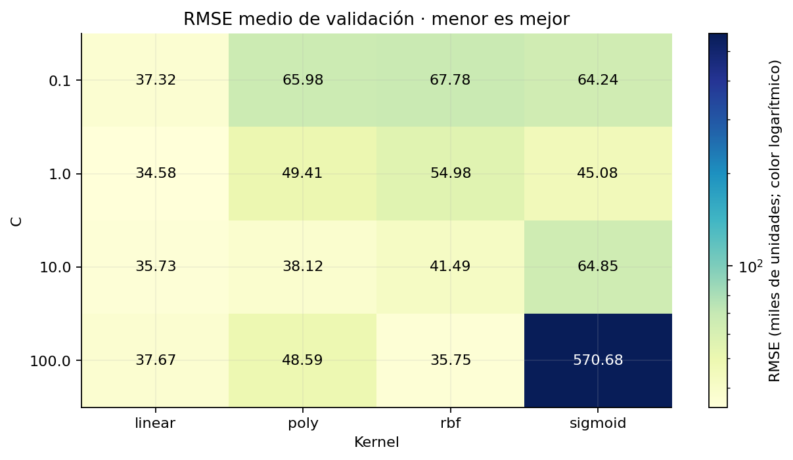
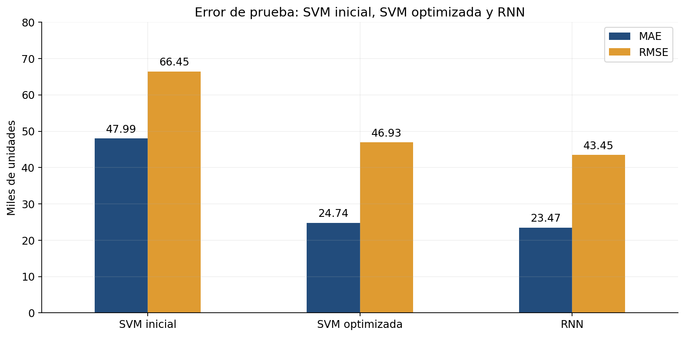
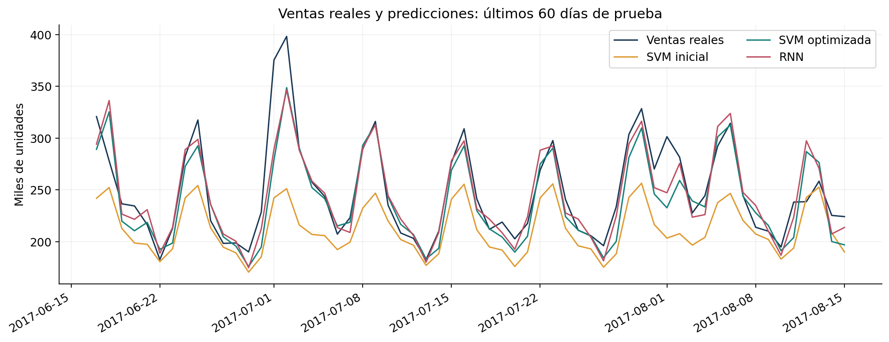
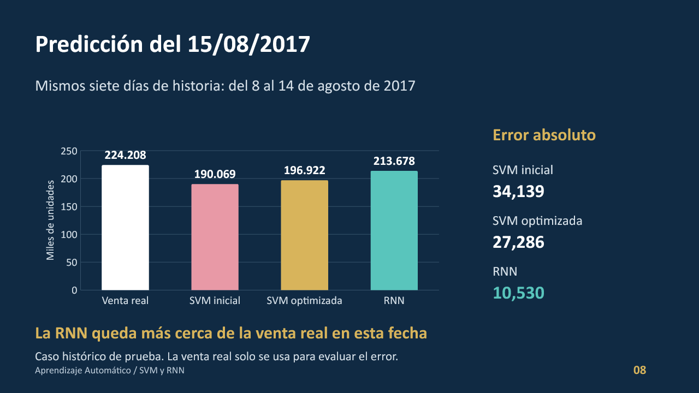
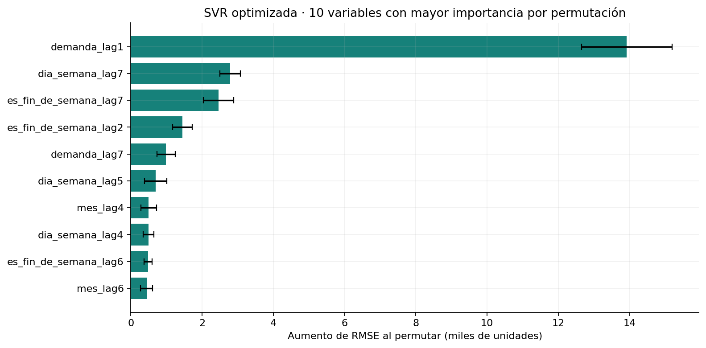

# Comparación SVM y RNN para demanda retail (Store Sales - Kaggle)

Predicción de ventas diarias de GROCERY I, agregadas entre 54 tiendas, con
SVM de regresión (inicial y optimizada con GridSearchCV) y RNN. MLflow registra
los modelos, parámetros, métricas y candidatos. Todas las cantidades se expresan
en **miles de unidades**.

## Requisitos

1. Python 3.12 con conda o venv.
2. Para ejecutar los tres cuadernos, usar el entorno compatible con RNN:

   ```powershell
   py -3.12 -m venv .venv-rnn
   & .\.venv-rnn\Scripts\python.exe -m pip install -r requirements-rnn.txt
   ```

   Seleccionar `.venv-rnn/Scripts/python.exe` como kernel. El archivo
   `requirements.txt` corresponde al flujo SVM original y no debe instalarse
   encima del entorno RNN.
3. **Descargar los datos de Kaggle** (ver sección Datos).

## Datos

El dataset no se incluye en el repositorio por el límite de 100 MB de GitHub.

1. Crea cuenta en https://www.kaggle.com
2. Entra a la competencia y **acepta las reglas**:
   https://www.kaggle.com/competitions/store-sales-time-series-forecasting/rules
3. Descarga el ZIP y extrae estos CSV en la carpeta `data/raw/`:
   - train.csv  (obligatorio)
   - stores.csv, oil.csv, holidays_events.csv, transactions.csv, sample_submission.csv (opcionales para este flujo)

## Cuaderno de comparación (SVM inicial y optimizada)

Abrir `Comparacion_SVM_GROCERY_I_MLflow.ipynb` en VS Code con la extensión
Jupyter, seleccionar el entorno `.venv-rnn` y
ejecutar todas las celdas en orden. También se puede abrir en una instalación
existente de Jupyter. El cuaderno incluye explicaciones y resultados ejecutados.

- Detecta `train.csv` tanto en `data/raw/` como en la carpeta existente
  `store-sales-time-series-forecasting (2)/`; no hace falta mover los CSV.
- Mantiene GROCERY I, 7 rezagos por 5 variables, la separación temporal 80/20 y
  16 candidatos con 3 pliegues de validación temporal.
- Recalcula MAE/RMSE, persistencia y gráficos, con unidades en **miles de unidades**.
  Corrige la importancia por permutación para medir aumento de RMSE explícitamente.
- Documenta los cuatro días ausentes imputados con cero y las fechas especiales
  heredadas de 2019, que quedan inactivas en este historial.
- Evalúa predicción de **un día con historia real disponible**; no un pronóstico
  de todos los meses de prueba emitido de una sola vez.
- Registra las dos SVM y 16 candidatos hijos. Las secciones 15 y 16 incorporan
  la RNN compatible más reciente y dejan **tres modelos principales** en el mismo
  experimento. Se conservan los pipelines SVM y la RNN con sus escaladores.

Cada ejecución guarda sus tablas y figuras en `resultados_cuaderno/<grupo>/`,
sin sobrescribir `resultados/`. MLflow usa `mlflow_cuaderno.db` y
`mlartifacts_cuaderno/`. Para iniciar la interfaz desde el cuaderno, cambiar
`INICIAR_UI = True` en la sección 13 y ejecutar su celda. Se abrirá en
http://127.0.0.1:5002 y verificará que corresponda a esa base de datos.
Por defecto el inicio del servidor está desactivado; los registros se guardan
y los modelos se verifican directamente contra SQLite, sin servidor.

Para abrir la interfaz otro día, desde esta carpeta y con el mismo entorno:

```powershell
python -m mlflow server --backend-store-uri sqlite:///mlflow_cuaderno.db --host 127.0.0.1 --port 5002 --no-serve-artifacts --workers 1
```

En el experimento `Comparacion_SVR_GROCERY_I_Cuaderno`, filtrar por la etiqueta
`comparacion` impresa al ejecutar, seleccionar las **3 ejecuciones principales** (SVR inicial, SVR optimizada y RNN)
y pulsar **Compare**. Comparar `test_mae`, `test_rmse` y `cv_rmse`.
`kernel` y `C` solo corresponden a SVM.
Expandir la optimizada para revisar los candidatos por su `cv_rmse`.
Los candidatos guardan sus resultados de validación; los tres modelos
principales contienen artefactos recuperables. Conservar tanto la base como
los artefactos para volver a cargar los pipelines.

## Comparación RNN y SVM en un cuaderno independiente

`Comparacion_RNN_vs_SVM_GROCERY_I_MLflow.ipynb` complementa al cuaderno SVM.
Predice las mismas ventas diarias de GROCERY I (54 tiendas agregadas, miles de
unidades), con idénticas ventanas, fechas de prueba y tres pliegues temporales.
La SVM recibe 35 columnas y la RNN la misma información en secuencias de 7 × 5.
Se comparan SVR inicial/optimizada, RNN inicial/optimizada y persistencia.

Para abrirlo en este equipo, seleccionar el intérprete
`.venv-rnn/Scripts/python.exe` en VS Code/Jupyter. El entorno separado contiene
NumPy 1.26 y protobuf 4 para ser compatible con TensorFlow 2.16. El entorno
original de SVM conserva sus paquetes. La red se ejecuta en CPU y limita hilos.

Para prepararlo en otro equipo con Python 3.12:

```powershell
py -3.12 -m venv .venv-rnn
& .\.venv-rnn\Scripts\python.exe -m pip install -r requirements-rnn.txt
```

Ejecutar el cuaderno completo, en orden. El entrenamiento repetitivo está en
`rnn_demanda.py`; no es necesario editarlo para ejecutar el cuaderno.

- Recalcula las dos SVR con la grilla original, sin depender de resultados antiguos.
- Usa SimpleRNN, 16/32 neuronas y tasas 0.001/0.003 (4 candidatos × 3 pliegues).
- Elige las épocas con EarlyStopping en una partición interna de cada train;
  evalúa el candidato en una validación externa distinta. Reentrena al final
  con todo el train usando la mediana de épocas seleccionadas, nunca el test.
- Invierte el escalado de la respuesta antes de calcular MAE/RMSE en miles de unidades.
- Exporta tablas, gráficos, casos de siete días, conclusión y modelos recuperables
  a `resultados_rnn/<grupo>/`. Conserva las salidas SVM anteriores.
- Registra cuatro modelos principales y cuatro candidatos RNN en el experimento
  `Comparacion_SVR_RNN_GROCERY_I`, en la misma base `mlflow_cuaderno.db`.
  Las RNN se guardan como artefactos `.keras` con sus dos escaladores.
- Comprueba que los cuatro modelos recuperados reproducen sus predicciones;
  también recupera y verifica una RNN desde los artefactos de MLflow.

La evaluación es diaria, con ventas reales anteriores disponibles. No es un
pronóstico de todos los meses emitido desde una única fecha. Se conserva la
imputación original de cuatro días ausentes y la variable especial de 2019
(inactiva en este historial), y se informa una evaluación adicional sin los
objetivos imputados. Las búsquedas tienen presupuestos distintos; los resultados
describen estos experimentos concretos. No se presupone que la RNN gane.

## Ejecutar el script original

python main.py

Esto:
- Carga train.csv y filtra la familia GROCERY I
- Construye features (7 lags x 5 variables = 35 columnas)
- Entrena SVR base y optimizada (GridSearchCV, 16 candidatos x 3 pliegues)
- Genera gráficos en resultados/
- Levanta MLflow y registra 2 runs principales + 16 candidatas
- Verifica la carga del modelo desde MLflow

## Estructura

- svm_demanda/ : codigo modular (config, datos, features, particion,
  modelos, evaluacion, interpretacion, tracking, prediccion)
- main.py      : orquestador (un solo comando)
- data/raw/    : CSV de Kaggle (no versionado)
- resultados/  : metricas, predicciones y graficos .png
- notebooks/   : exploracion
- probar_candidato.py : carga un modelo de MLflow por Run ID y predice

## Resultados de la comparación

Los tres modelos se evalúan en las mismas **337 fechas de prueba**, del
13/09/2016 al 15/08/2017, con siete días de historia real anterior disponible.
La partición temporal reserva 1344 días para entrenamiento. Los parámetros se
seleccionan con validación, antes de evaluar la prueba.

| Modelo | MAE de prueba | RMSE de prueba |
|---|---:|---:|
| SVM inicial | 47.99 | 66.45 |
| SVM optimizada | 24.74 | 46.93 |
| RNN | 23.47 | 43.45 |

La RNN reduce el RMSE un **7.41%** frente a SVM optimizada en esta prueba.
La búsqueda RNN conserva su configuración inicial, por eso se muestra una sola
RNN. Un MAE de 23.47 equivale aproximadamente a 23 470 unidades de error diario.

## Gráficos

### RMSE de validación según kernel y C

**GridSearchCV** evalúa cuatro kernels y cuatro valores de C:
**16 combinaciones × 3 pliegues temporales = 48 ajustes de validación**, más
el reajuste final del ganador. El mapa conserva las 16 combinaciones.
Gana el **kernel lineal con C = 1**, con **RMSE medio de validación 34.58**.
La escala de color es logarítmica. Estos valores son de validación, no de prueba.



### Comparación de errores de los tres modelos

MAE y RMSE en las mismas 337 fechas de prueba. **Menor es mejor**.
Estos errores están en miles de unidades y se calculan después de seleccionar
los modelos mediante validación temporal.



### Ventas reales frente a las tres predicciones

Acercamiento a los últimos 60 días de prueba. La comparación global anterior
usa todos los días, no solo este acercamiento. Ningún modelo acierta mejor
en todas las fechas.



### Ejemplo de predicción con los tres modelos

Última diapositiva de la exposición: predicción del **15/08/2017** con los mismos
siete días de historia. La venta real fue **224.208 miles de unidades** y la RNN
estimó **213.678**, con el menor error absoluto en esa fecha (**10.530**).
Es un caso histórico de prueba; la evaluación general utiliza los 337 días.



### Importancia de las variables de SVM optimizada

La importancia por permutación mide el aumento de RMSE al alterar una variable.
Este gráfico corresponde únicamente a la SVM optimizada.



## Preparar y reproducir los resultados

1. `Comparacion_RNN_vs_SVM_GROCERY_I_MLflow.ipynb`: entrenar la RNN.
2. `Comparacion_SVM_GROCERY_I_MLflow.ipynb`: entrenar las SVM e integrar los tres
   modelos en `Comparacion_SVR_GROCERY_I_Cuaderno`.
3. `Prueba_3_Modelos_por_ID.ipynb`: recuperar los modelos mediante Run ID y predecir.

Ver [orden de ejecución](ORDEN_EJECUCION.md). Los registros MLflow y los resultados
por ejecución se conservan localmente. Las imágenes y tablas de esta página se
publican en `resultados/`, que sí se incluye en Git:

- [Métricas de los tres modelos](resultados/comparacion_tres_modelos.csv).
- [Predicciones por fecha](resultados/predicciones_tres_modelos.csv).
- [Resultados de GridSearchCV](resultados/gridsearch.csv).

Fuentes de las figuras: cuaderno original, ejecución **20261116_142209_0cef8e**,
y RNN **20261116_141858_0cdb2f**. Las imágenes se exportaron de los resultados
verificados, sin volver a entrenar ni modificar los datos.

Se conservan cuatro fechas ausentes imputadas con cero, una dentro de prueba.
Los cuadernos también muestran métricas sin esa respuesta imputada. Se evalúa
un día con historia real disponible, no varios meses emitidos desde una sola fecha.
