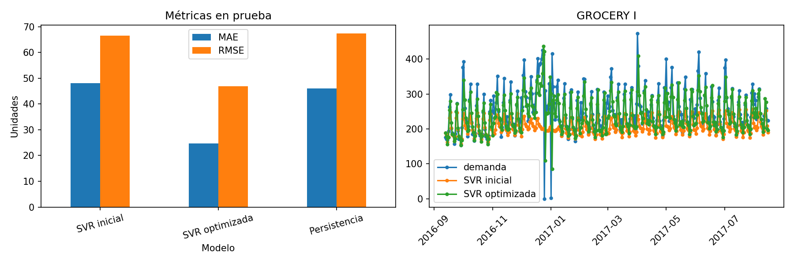
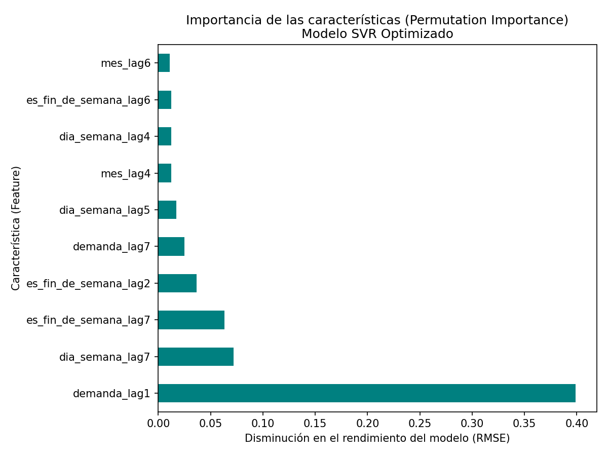
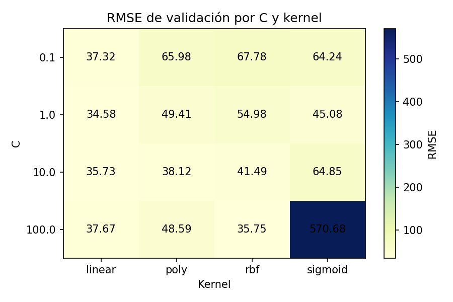

# SVM Demanda Retail (Store Sales - Kaggle)

Predicción de demanda diaria por familia de producto (GROCERY I) con SVR
(base vs. optimizada con GridSearchCV) y seguimiento en MLflow.

## Requisitos

1. Python 3.12 con conda o venv.
2. Instalar dependencias:
   pip install -r requirements.txt
3. **Descargar los datos de Kaggle** (ver sección Datos).

## Datos

El dataset no se incluye en el repositorio por el límite de 100 MB de GitHub.

1. Crea cuenta en https://www.kaggle.com
2. Entra a la competencia y **acepta las reglas**:
   https://www.kaggle.com/competitions/store-sales-time-series-forecasting/rules
3. Descarga el ZIP y extrae estos CSV en la carpeta `data/raw/`:
   - train.csv  (obligatorio)
   - stores.csv, oil.csv, holidays_events.csv, transactions.csv, sample_submission.csv (opcionales para este flujo)

## Cuaderno de comparación (SVM inicial y optimizada)

Abrir `Comparacion_SVM_GROCERY_I_MLflow.ipynb` en VS Code con la extensión
Jupyter, seleccionar el entorno donde se instalaron `requirements.txt` y
ejecutar todas las celdas en orden. También se puede abrir en una instalación
existente de Jupyter. El cuaderno incluye explicaciones y resultados ejecutados.

- Detecta `train.csv` tanto en `data/raw/` como en la carpeta existente
  `store-sales-time-series-forecasting (2)/`; no hace falta mover los CSV.
- Mantiene GROCERY I, 7 rezagos por 5 variables, la separación temporal 80/20 y
  16 candidatos con 3 pliegues de validación temporal.
- Recalcula MAE/RMSE, persistencia y gráficos, con unidades en **miles de unidades**.
  Corrige la importancia por permutación para medir aumento de RMSE explícitamente.
- Documenta los cuatro días ausentes imputados con cero y las fechas especiales
  heredadas de 2019, que quedan inactivas en este historial.
- Evalúa predicción de **un día con historia real disponible**; no un pronóstico
  de todos los meses de prueba emitido de una sola vez.
- Registra 2 modelos principales y 16 candidatos hijos en MLflow, guarda ambos
  pipelines y comprueba sus predicciones después de recuperarlos.

Cada ejecución guarda sus tablas y figuras en `resultados_cuaderno/<grupo>/`,
sin sobrescribir `resultados/`. MLflow usa `mlflow_cuaderno.db` y
`mlartifacts_cuaderno/`. Para iniciar la interfaz desde el cuaderno, cambiar
`INICIAR_UI = True` en la sección 13 y ejecutar su celda. Se abrirá en
http://127.0.0.1:5002 y verificará que corresponda a esa base de datos.
Por defecto el inicio del servidor está desactivado; los registros se guardan
y los modelos se verifican directamente contra SQLite, sin servidor.

Para abrir la interfaz otro día, desde esta carpeta y con el mismo entorno:

```powershell
python -m mlflow server --backend-store-uri sqlite:///mlflow_cuaderno.db --host 127.0.0.1 --port 5002 --no-serve-artifacts --workers 1
```

En el experimento `Comparacion_SVR_GROCERY_I_Cuaderno`, filtrar por la etiqueta
`comparacion` impresa al ejecutar, seleccionar las 2 ejecuciones principales y
pulsar **Compare**. Comparar `test_mae`, `test_rmse`, `cv_rmse`, `kernel` y `C`.
Expandir la optimizada para revisar los candidatos por su `cv_rmse`.
Los candidatos guardan sus resultados de validación; solo las dos ejecuciones
principales contienen modelos recuperables. Conservar tanto la base como
los artefactos para volver a cargar los pipelines.

## Ejecutar el script original

python main.py

Esto:
- Carga train.csv y filtra la familia GROCERY I
- Construye features (7 lags x 5 variables = 35 columnas)
- Entrena SVR base y optimizada (GridSearchCV, 16 candidatos x 3 pliegues)
- Genera gráficos en resultados/
- Levanta MLflow y registra 2 runs principales + 16 candidatas
- Verifica la carga del modelo desde MLflow

## Estructura

- svm_demanda/ : codigo modular (config, datos, features, particion,
  modelos, evaluacion, interpretacion, tracking, prediccion)
- main.py      : orquestador (un solo comando)
- data/raw/    : CSV de Kaggle (no versionado)
- resultados/  : metricas, predicciones y graficos .png
- notebooks/   : exploracion
- probar_candidato.py : carga un modelo de MLflow por Run ID y predice

## Resultados esperados

| Modelo | MAE | RMSE |
|---|---|---|
| SVR inicial (C=1, rbf) | 47.99 | 66.45 |
| SVR optimizada (C=1, linear) | 24.74 | 46.93 |
| Persistencia | 45.97 | 67.28 |

Reduccion de MAE: 48.45% | Reduccion de RMSE: 29.38%

## Graficos




